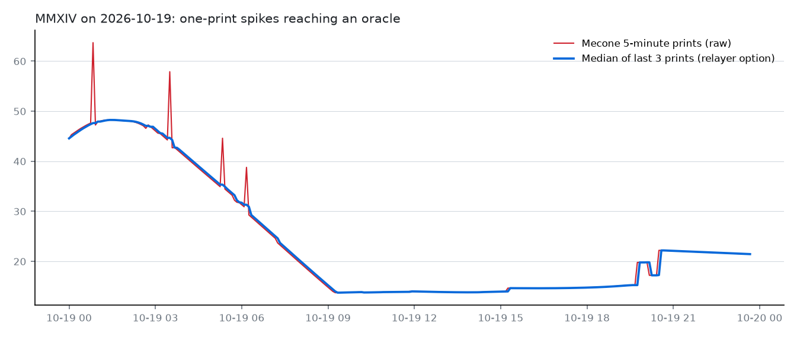

# Mecone indices as Hyperliquid HIP-3 perps: listing readiness

Data: Mecone's public index API (`api.mecone.trade/api/v1`) and Hyperliquid mainnet, pulled 2026-10-19 23:48 UTC.
History is short: hourly bars cover the last month, 5-minute bars the last week, and daily bars go back to
August 2026 (October 2025 for the volatility indices). Mecone flags these histories as indicative, not official,
and its own statistics endpoint reports too few observations for annualized volatility. Read every number
below as an early measurement.

## Summary

| Index | Value | 50%+ intraday days | Biggest 5-min step | One-print spikes (week) | 5-min gaps >15 min | Source volume | Suggested max leverage | Suggested margin mode |
|---|---|---|---|---|---|---|---|---|
| MB200 B200 rental $/hr (end-July) | 6.442 $/hr | 0 of 70 | 0.54% | 0 | 0 | $45,965 | 2x | noCross (isolated only) |
| MH100 H100 rental $/hr (end-July) | 2.696 $/hr | 0 of 70 | 3.34% | 0 | 0 | $37,809 | 5x | noCross (isolated only) |
| MH200 H200 rental $/hr (end-July) | 5.319 $/hr | 0 of 70 | 1.47% | 0 | 0 | $59,337 | 2x | noCross (isolated only) |
| MANTH Anthropic | $1.76T | 0 of 70 | 4.88% | 0 | 7 | $3,039,210 | 5x | normal (cross allowed) |
| MOAI OpenAI | $1.09T | 0 of 70 | 0.68% | 0 | 7 | $522,364 | 10x | normal (cross allowed) |
| MCPI CPI inflation YoY | 3.703 % | 0 of 70 | 1.98% | 0 | 1 | $17,524 | 10x | noCross (isolated only) |
| MGDP GDP growth | 2.671 % | 0 of 70 | 2.32% | 0 | 3 | $61,305 | 5x | noCross (isolated only) |
| MUNEMP Unemployment rate | 4.194 % | 0 of 69 | 0.05% | 0 | 1 | $15,693 | 10x | noCross (isolated only) |
| MARGIV Argentina Volatility Index | 36.35 pts | 97 of 359 | 19.29% | 52 | 1 | $734,730 | 1x | noCross (isolated only) |
| MBRIV Brazil Volatility Index | 39.71 pts | 29 of 365 | 14.65% | 63 | 1 | $4,040,500 | 1x | noCross (isolated only) |
| MCHNIV China Volatility Index | 31.72 pts | 5 of 366 | 10.41% | 32 | 1 | $68,179,288 | 1x | normal (cross allowed) |
| MMXIV Mexico Volatility Index | 21.43 pts | 101 of 364 | 33.72% | 89 | 1 | $33,195 | 1x | noCross (isolated only) |

## What stands out

- **The four emerging-market volatility indices are not ready for leverage.** Their daily bars show 50%+ intraday moves on MBRIV 29, MMXIV 101, MARGIV 97, MCHNIV 5 days. HIP-3 validators review every 50% move from the start of day, and assets doing that more than once a month are not eligible for cross margin.
- **One-print spikes.** Over the last week the volatility indices printed jumps of 5%+ that reverted on the very next 5-minute print MBRIV 63x, MMXIV 89x, MARGIV 52x, MCHNIV 32x. Passed straight to an oracle, each one moves every position's mark and liquidation price. A median of the last 3 prints removes the worst of it (chart below), at the cost of up to 10 minutes of lag.
- **Thin source markets.** MH100, MH200, MB200, MGDP, MCPI, MUNEMP, MMXIV are built on prediction-market contracts with under $100K of lifetime volume. An exchange should keep open-interest caps small and isolated margin only until the source deepens.
- **Data gaps.** Several indices have stretches of 15+ minutes with no new 5-minute point. The relayer halts trading on those assets instead of letting the mark drift on an old value (see the replay table).
- **The AI-company, GPU and US macro indices behave calmly.** Their largest intraday moves range from 1.6% to 16.2%, and the suggested max leverage is 2–10x. MCHNIV passes the cross-margin screen yet gets 1x leverage: eligibility looks at how often 50% days happen, leverage at how large the tail moves are.

## Relayer replay (last week of 5-minute data, setOracle every 3 seconds)

Each run sends a setOracle every 3 seconds, steps the mark at most 1% per update, and halts an asset when Mecone has no new value for 15 minutes or the price moves more than 40% from the start of day.

| Index | Halts (raw) | Halts (median of 3) | Largest mark–oracle gap raw / median3 | Longest catch-up raw / median3 |
|---|---|---|---|---|
| MB200 | 0 | 0 | 0.00% / 0.00% | 0s / 0s |
| MH100 | 0 | 0 | 2.42% / 2.06% | 9s / 9s |
| MH200 | 0 | 0 | 0.48% / 0.48% | 3s / 3s |
| MANTH | 7 | 7 | 3.93% / 3.60% | 12s / 12s |
| MOAI | 7 | 7 | 0.00% / 0.00% | 0s / 0s |
| MCPI | 1 | 1 | 0.98% / 0.75% | 3s / 3s |
| MGDP | 3 | 3 | 1.37% / 1.37% | 6s / 6s |
| MUNEMP | 1 | 1 | 0.00% / 0.00% | 0s / 0s |
| MARGIV | 6 | 3 | 17.37% / 14.21% | 51s / 42s |
| MBRIV | 1 | 1 | 16.01% / 15.58% | 45s / 45s |
| MCHNIV | 1 | 1 | 10.51% / 7.20% | 33s / 24s |
| MMXIV | 9 | 4 | 31.22% / 17.73% | 84s / 51s |

## Per-index detail

### MB200: B200 rental $/hr (end-July)

- Value 6.442 $/hr; oracle-eligible: True; anchor freshness: no anchor.
- History: daily from 2026-08-11 (70 days); 1969 five-minute points in the last week.
- Largest intraday move from the day's open: 14.3% (last month: 14.3%). Days over 25%: 0; over 50%: 0.
- 5-minute steps: largest 0.54%, 99th percentile 0.09%; a 1%-per-update mark needs 3s to absorb the largest. One-print spikes: 0.
- Flat stretches of an hour or more: 22 (longest 8.9h). Gaps over 15 minutes: 0 (longest 0 min).
- Hourly annualized volatility 55.0%; 99.9th-percentile 24-hour move 14.2%.
- Share of hourly entries (long and short) liquidated within 7 days, isolated: 2x 0.0%, 3x 0.0%, 5x 11.7%, 10x 15.4%, 20x 18.2%.
- Source markets: Polymarket $45,965.
- **Suggested: 2x max leverage, noCross (isolated only).** Source markets total $45,965 lifetime volume

### MH100: H100 rental $/hr (end-July)

- Value 2.696 $/hr; oracle-eligible: True; anchor freshness: no anchor.
- History: daily from 2026-08-11 (70 days); 1969 five-minute points in the last week.
- Largest intraday move from the day's open: 7.9% (last month: 6.9%). Days over 25%: 0; over 50%: 0.
- 5-minute steps: largest 3.34%, 99th percentile 1.20%; a 1%-per-update mark needs 12s to absorb the largest. One-print spikes: 0.
- Flat stretches of an hour or more: 4 (longest 4.7h). Gaps over 15 minutes: 0 (longest 0 min).
- Hourly annualized volatility 60.6%; 99.9th-percentile 24-hour move 6.1%.
- Share of hourly entries (long and short) liquidated within 7 days, isolated: 2x 0.0%, 3x 0.0%, 5x 1.5%, 10x 19.5%, 20x 55.0%.
- Source markets: Polymarket $37,809.
- **Suggested: 5x max leverage, noCross (isolated only).** Source markets total $37,809 lifetime volume

### MH200: H200 rental $/hr (end-July)

- Value 5.319 $/hr; oracle-eligible: True; anchor freshness: no anchor.
- History: daily from 2026-08-11 (70 days); 1968 five-minute points in the last week.
- Largest intraday move from the day's open: 16.2% (last month: 16.2%). Days over 25%: 0; over 50%: 0.
- 5-minute steps: largest 1.47%, 99th percentile 0.43%; a 1%-per-update mark needs 6s to absorb the largest. One-print spikes: 0.
- Flat stretches of an hour or more: 7 (longest 5.4h). Gaps over 15 minutes: 0 (longest 0 min).
- Hourly annualized volatility 66.2%; 99.9th-percentile 24-hour move 15.7%.
- Share of hourly entries (long and short) liquidated within 7 days, isolated: 2x 0.0%, 3x 3.2%, 5x 12.2%, 10x 34.7%, 20x 53.3%.
- Source markets: Polymarket $59,337.
- **Suggested: 2x max leverage, noCross (isolated only).** Source markets total $59,337 lifetime volume

### MANTH: Anthropic

- Value $1.76T; oracle-eligible: True; anchor freshness: fresh.
- History: daily from 2026-08-11 (70 days); 1913 five-minute points in the last week.
- Largest intraday move from the day's open: 8.1% (last month: 4.8%). Days over 25%: 0; over 50%: 0.
- 5-minute steps: largest 4.88%, 99th percentile 2.14%; a 1%-per-update mark needs 15s to absorb the largest. One-print spikes: 0.
- Flat stretches of an hour or more: 0 (longest 0.0h). Gaps over 15 minutes: 7 (longest 40 min).
- Hourly annualized volatility 49.4%; 99.9th-percentile 24-hour move 4.5%.
- Share of hourly entries (long and short) liquidated within 7 days, isolated: 2x 0.0%, 3x 0.0%, 5x 5.2%, 10x 21.1%, 20x 53.3%.
- Source markets: Polymarket $3,039,210.
- **Suggested: 5x max leverage, normal (cross allowed).** 0.0 days a month with 50%+ moves over 70 days, and source markets above $100k lifetime volume

### MOAI: OpenAI

- Value $1.09T; oracle-eligible: True; anchor freshness: fresh.
- History: daily from 2026-08-11 (70 days); 1922 five-minute points in the last week.
- Largest intraday move from the day's open: 3.1% (last month: 2.2%). Days over 25%: 0; over 50%: 0.
- 5-minute steps: largest 0.68%, 99th percentile 0.43%; a 1%-per-update mark needs 3s to absorb the largest. One-print spikes: 0.
- Flat stretches of an hour or more: 30 (longest 3.0h). Gaps over 15 minutes: 7 (longest 30 min).
- Hourly annualized volatility 16.7%; 99.9th-percentile 24-hour move 2.2%.
- Share of hourly entries (long and short) liquidated within 7 days, isolated: 2x 0.0%, 3x 0.0%, 5x 0.0%, 10x 0.0%, 20x 1.1%.
- Source markets: Polymarket $522,364.
- **Suggested: 10x max leverage, normal (cross allowed).** 0.0 days a month with 50%+ moves over 70 days, and source markets above $100k lifetime volume

### MCPI: CPI inflation YoY

- Value 3.703 %; oracle-eligible: True; anchor freshness: no anchor.
- History: daily from 2026-08-11 (70 days); 1920 five-minute points in the last week.
- Largest intraday move from the day's open: 1.6% (last month: 1.6%). Days over 25%: 0; over 50%: 0.
- 5-minute steps: largest 1.98%, 99th percentile 0.28%; a 1%-per-update mark needs 6s to absorb the largest. One-print spikes: 0.
- Flat stretches of an hour or more: 1 (longest 27.4h). Gaps over 15 minutes: 1 (longest 250 min).
- Hourly annualized volatility 8.3%; 99.9th-percentile 24-hour move 1.9%.
- Share of hourly entries (long and short) liquidated within 7 days, isolated: 2x 0.0%, 3x 0.0%, 5x 0.0%, 10x 0.0%, 20x 5.3%.
- Source markets: Polymarket $17,524.
- **Suggested: 10x max leverage, noCross (isolated only).** Source markets total $17,524 lifetime volume

### MGDP: GDP growth

- Value 2.671 %; oracle-eligible: True; anchor freshness: no anchor.
- History: daily from 2026-08-11 (70 days); 1947 five-minute points in the last week.
- Largest intraday move from the day's open: 4.4% (last month: 4.1%). Days over 25%: 0; over 50%: 0.
- 5-minute steps: largest 2.32%, 99th percentile 1.11%; a 1%-per-update mark needs 9s to absorb the largest. One-print spikes: 0.
- Flat stretches of an hour or more: 0 (longest 0.0h). Gaps over 15 minutes: 3 (longest 40 min).
- Hourly annualized volatility 52.6%; 99.9th-percentile 24-hour move 4.8%.
- Share of hourly entries (long and short) liquidated within 7 days, isolated: 2x 0.0%, 3x 0.0%, 5x 0.1%, 10x 25.9%, 20x 51.3%.
- Source markets: Polymarket $61,305.
- **Suggested: 5x max leverage, noCross (isolated only).** Source markets total $61,305 lifetime volume

### MUNEMP: Unemployment rate

- Value 4.194 %; oracle-eligible: True; anchor freshness: no anchor.
- History: daily from 2026-08-12 (69 days); 1961 five-minute points in the last week.
- Largest intraday move from the day's open: 2.1% (last month: 2.1%). Days over 25%: 0; over 50%: 0.
- 5-minute steps: largest 0.05%, 99th percentile 0.02%; a 1%-per-update mark needs 3s to absorb the largest. One-print spikes: 0.
- Flat stretches of an hour or more: 0 (longest 0.0h). Gaps over 15 minutes: 1 (longest 20 min).
- Hourly annualized volatility 8.2%; 99.9th-percentile 24-hour move 2.4%.
- Share of hourly entries (long and short) liquidated within 7 days, isolated: 2x 0.0%, 3x 0.0%, 5x 0.0%, 10x 0.0%, 20x 0.1%.
- Source markets: Polymarket $15,693.
- **Suggested: 10x max leverage, noCross (isolated only).** Source markets total $15,693 lifetime volume

### MARGIV: Argentina Volatility Index

- Value 36.35 pts; oracle-eligible: True; anchor freshness: no anchor.
- History: daily from 2025-10-19 (359 days); 2013 five-minute points in the last week.
- Largest intraday move from the day's open: 322.0% (last month: 111.4%). Days over 25%: 240; over 50%: 97.
- 5-minute steps: largest 19.29%, 99th percentile 10.27%; a 1%-per-update mark needs 54s to absorb the largest. One-print spikes: 52 (largest at 2026-10-15 07:50:00+00:00: +18.8% then -14.6%).
- Flat stretches of an hour or more: 0 (longest 0.0h). Gaps over 15 minutes: 1 (longest 25 min).
- Hourly annualized volatility 481.8%; 99.9th-percentile 24-hour move 90.3%.
- Share of hourly entries (long and short) liquidated within 7 days, isolated: 2x 74.7%, 3x 86.2%, 5x 93.3%, 10x 96.7%, 20x 97.7%.
- Source markets: Kalshi $7,464, Polymarket $727,266.
- **Suggested: 1x max leverage, noCross (isolated only).** 8.1 days a month with 50%+ moves

### MBRIV: Brazil Volatility Index

- Value 39.71 pts; oracle-eligible: True; anchor freshness: no anchor.
- History: daily from 2025-10-19 (365 days); 2013 five-minute points in the last week.
- Largest intraday move from the day's open: 99.3% (last month: 62.8%). Days over 25%: 145; over 50%: 29.
- 5-minute steps: largest 14.65%, 99th percentile 8.47%; a 1%-per-update mark needs 42s to absorb the largest. One-print spikes: 63 (largest at 2026-10-14 16:35:00+00:00: +12.9% then -9.2%).
- Flat stretches of an hour or more: 0 (longest 0.0h). Gaps over 15 minutes: 1 (longest 25 min).
- Hourly annualized volatility 353.3%; 99.9th-percentile 24-hour move 52.8%.
- Share of hourly entries (long and short) liquidated within 7 days, isolated: 2x 47.8%, 3x 65.8%, 5x 77.7%, 10x 88.4%, 20x 92.4%.
- Source markets: Polymarket $4,040,500.
- **Suggested: 1x max leverage, noCross (isolated only).** 2.4 days a month with 50%+ moves

### MCHNIV: China Volatility Index

- Value 31.72 pts; oracle-eligible: True; anchor freshness: no anchor.
- History: daily from 2025-10-19 (366 days); 2013 five-minute points in the last week.
- Largest intraday move from the day's open: 143.9% (last month: 51.3%). Days over 25%: 48; over 50%: 5.
- 5-minute steps: largest 10.41%, 99th percentile 7.23%; a 1%-per-update mark needs 30s to absorb the largest. One-print spikes: 32 (largest at 2026-10-17 09:05:00+00:00: +10.4% then -9.5%).
- Flat stretches of an hour or more: 0 (longest 0.0h). Gaps over 15 minutes: 1 (longest 25 min).
- Hourly annualized volatility 286.4%; 99.9th-percentile 24-hour move 49.0%.
- Share of hourly entries (long and short) liquidated within 7 days, isolated: 2x 34.4%, 3x 59.2%, 5x 83.3%, 10x 94.7%, 20x 97.6%.
- Source markets: Kalshi $16,814, Polymarket $68,162,474.
- **Suggested: 1x max leverage, normal (cross allowed).** 0.4 days a month with 50%+ moves over 366 days, and source markets above $100k lifetime volume

### MMXIV: Mexico Volatility Index

- Value 21.43 pts; oracle-eligible: True; anchor freshness: no anchor.
- History: daily from 2025-10-19 (364 days); 2013 five-minute points in the last week.
- Largest intraday move from the day's open: 303.0% (last month: 148.1%). Days over 25%: 251; over 50%: 101.
- 5-minute steps: largest 33.72%, 99th percentile 18.87%; a 1%-per-update mark needs 90s to absorb the largest. One-print spikes: 89 (largest at 2026-10-19 00:50:00+00:00: +33.7% then -25.8%).
- Flat stretches of an hour or more: 0 (longest 0.0h). Gaps over 15 minutes: 1 (longest 25 min).
- Hourly annualized volatility 754.4%; 99.9th-percentile 24-hour move 118.1%.
- Share of hourly entries (long and short) liquidated within 7 days, isolated: 2x 87.4%, 3x 94.4%, 5x 96.3%, 10x 97.8%, 20x 98.2%.
- Source markets: Polymarket $33,195.
- **Suggested: 1x max leverage, noCross (isolated only).** 8.3 days a month with 50%+ moves; source markets total $33,195 lifetime volume

## Hyperliquid today

- 10 HIP-3 dexes are live on mainnet: xyz (XYZ), flx (Felix Exchange), vntl (Ventuals), hyna (HyENA), km (Markets by Kinetiq), abcd (ABCDEx), cash (dreamcash), para (Paragon), mkts (Markets By Kinetiq), io (EntropyIO). None is Mecone's.
- Ventuals (`vntl`), the dex that listed pre-IPO perps (OpenAI, Anthropic, SpaceX) and sector baskets, shows 15 of 15 markets delisted, with zero open interest and volume. There is no live pre-IPO perp on HIP-3 to compare against.

## Method and limits

- **Leverage rule:** at max leverage L an isolated position is liquidated after an adverse move of about 1/(2L). The suggestion is the largest of 1, 2, 3, 5, 10 or 20x where 1/(2L) covers the 99.9th-percentile 24-hour move with a 1.5x safety factor. It is a starting point for a risk team, not Hyperliquid's or Mecone's rule.
- **Margin-mode rule:** cross margin is suggested only with at least 30 days of daily history, at most one 50%+ intraday day per month, and source markets above $100K lifetime volume. The protocol's actual eligibility review also weighs oracle reliability and manipulation resistance, which this report does not fully measure.
- **Price scale:** valuations are quoted per $1B, as Ventuals did; other indices at face value. Mecone may prefer other units.
- **Not measured:** order-book depth of the source contracts (only lifetime volume is public in Mecone's API), funding behaviour on a live book, and anything that needs a deployed HIP-3 dex.
